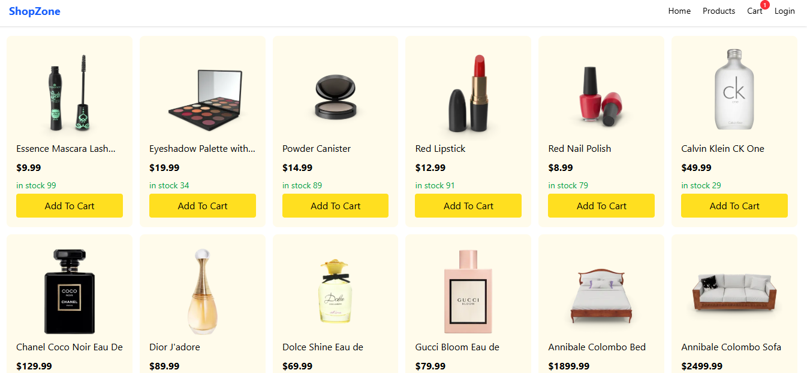
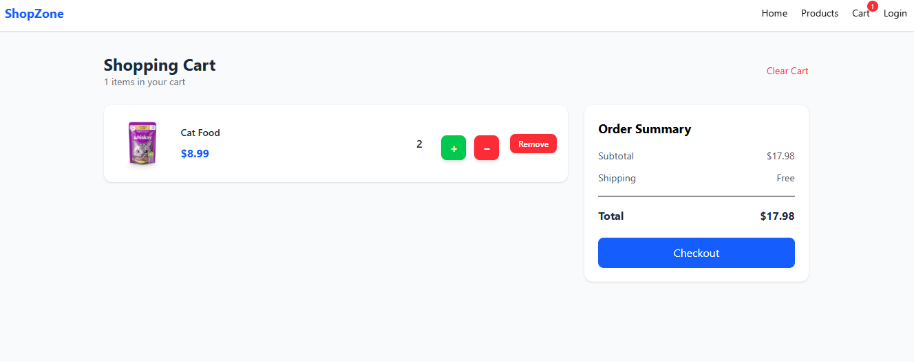

# 🛒 ShopZone

ShopZone is a modern e-commerce web application built with React and Redux Toolkit (RTK). Users can browse products, add items to the cart, manage cart quantities, and remove products from the cart. The application uses Redux Toolkit for efficient and scalable state management.

## 🚀 Features

- 🛍️ Display products from API
- ➕ Increase product quantity in cart
- ➖ Decrease product quantity in cart
- 🗑️ Remove products from cart
- 📦 Add products to cart
- 🔄 Centralized state management using Redux Toolkit (RTK)
- 🎨 Responsive and modern UI with Tailwind CSS

## 🛠️ Technologies Used

- React.js
- Redux Toolkit (RTK)
- React Redux
- Tailwind CSS
- JavaScript (ES6+)

## 🔥 Redux Toolkit Usage

This project uses Redux Toolkit (RTK) to manage cart state efficiently.

## 🎯 Learning Objective

The main goal of this project was to learn and practice:

- Redux Toolkit (RTK)
- State Management
- React Component Structure
- Dispatching Actions
- Using Selectors
- Cart Functionality Implementation

## 📸 Preview

ShopZone provides a simple and user-friendly shopping experience with efficient cart management powered by Redux Toolkit.

## 👨‍💻 Author

**Touhid Ahmed Tuhin**

Tech Enthusiast

---

⭐ If you like this project, give it a star on GitHub!